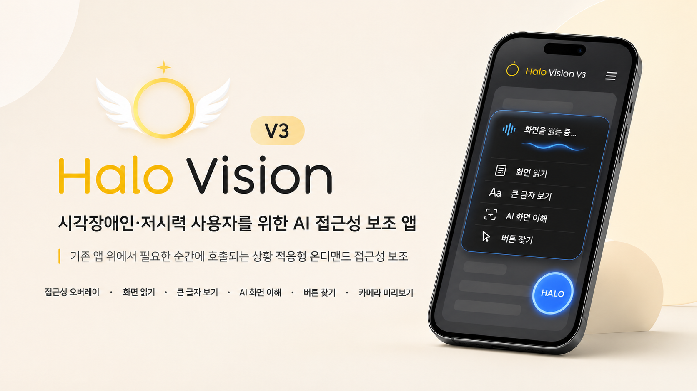
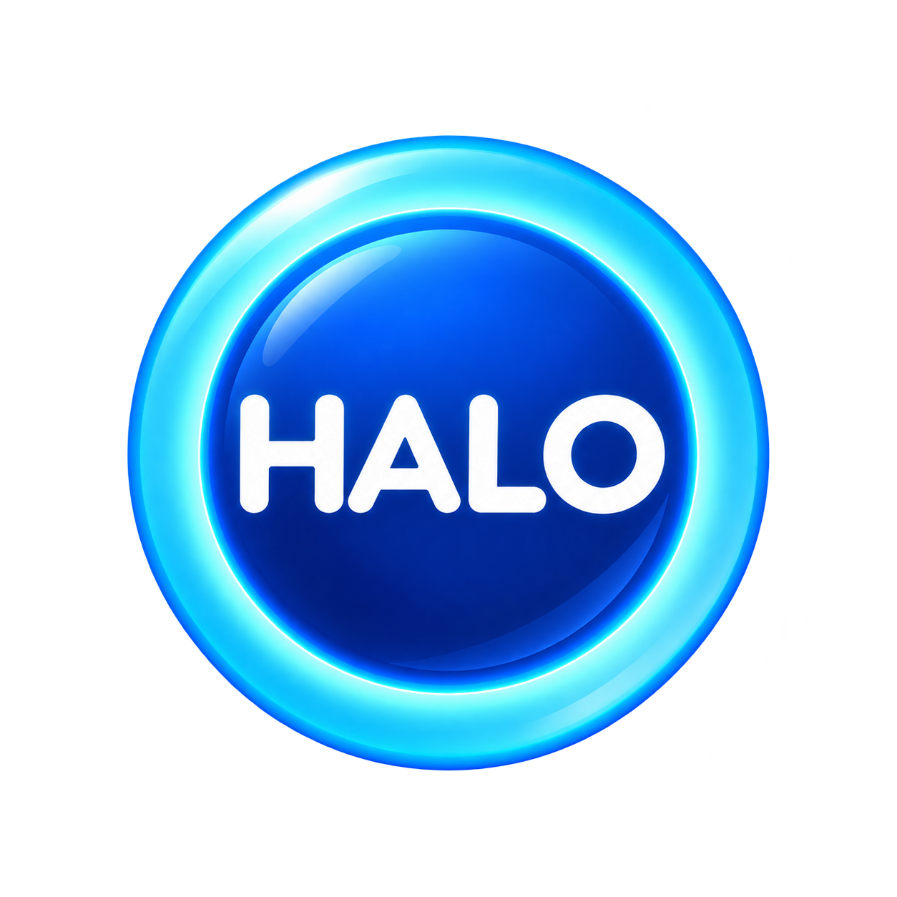

<div align="center">



<br><br>



# HaloVision V3

### 시각장애인·저시력 사용자를 위한 AI 기반 접근성 보조 앱

현재 사용 중인 화면 위에서 필요한 순간에 HALO를 호출하여  
화면을 읽고, 핵심 내용을 이해하고, 필요한 UI 요소를 찾을 수 있도록 돕는  
상황 적응형 모바일 접근성 시스템입니다.

<br>


</div>

---

## 프로젝트 소개

**HaloVision**은 시각장애인과 저시력 사용자가 스마트폰 화면의 정보를 보다 쉽게 확인하고 이해할 수 있도록 돕는 접근성 보조 애플리케이션입니다.

기존 HaloVision V2는 사용자의 시야 특성에 따라 문서 내용을 재배치하는 방식에 초점을 두었습니다.

실사용자 피드백을 통해 고정적인 화면 재배치만으로는 실제 사용 상황을 충분히 지원하기 어렵다는 점을 확인하였고, V3에서는 기존 앱 위에서 필요할 때 바로 호출할 수 있는 **상황 적응형 온디맨드 접근성 보조 시스템**으로 방향을 확장했습니다.

> 화면을 바꾸는 접근성에서, 필요한 순간에 개입하는 접근성으로.

HaloVision V3는 사용자가 현재 보고 있는 화면을 기반으로 다음 흐름을 지원합니다.

**보기 → 읽기 → 이해 → 행동**

---

## 주요 기능

### HALO 접근성 오버레이

Android AccessibilityService를 기반으로 다른 앱을 사용하는 중에도 HALO 버튼을 호출할 수 있습니다.

HALO를 통해 현재 화면을 벗어나지 않고 주요 접근성 기능을 실행할 수 있습니다.

- 보기 편하게
- 중요한 내용만 보기
- 화면 읽어주기
- 질문하기
- 사용자 설정
- HaloVision 카메라

---

### 보기 편하게

사용자가 현재 보고 있는 화면을 더 쉽게 확인할 수 있도록 확대 기능과 큰 글자 보기를 제공합니다.

Accessibility Node Tree와 ML Kit OCR을 함께 활용하여 화면의 텍스트를 추출하고, 사용자의 설정에 맞는 읽기 쉬운 형태로 제공합니다.

---

### 화면 읽어주기

현재 화면에서 추출한 텍스트를 Android Text To Speech 기능을 이용하여 음성으로 제공합니다.

사용자는 읽기 속도를 조절할 수 있으며, 화면을 직접 읽기 어려운 상황에서도 내용을 확인할 수 있습니다.

---

### 중요한 내용만 보기

현재 화면에서 수집한 텍스트와 화면 정보를 AI가 분석하여 사용자가 우선적으로 확인해야 할 핵심 내용을 제공합니다.

텍스트 정보만으로 현재 화면을 충분히 이해하기 어려운 경우 Vision 분석을 추가로 수행합니다.

---

### 화면 기반 질문

사용자가 현재 화면을 기준으로 자연어 질문을 할 수 있습니다.

예시:

```text
이 화면에서 중요한 내용이 뭐야?
신청 기간이 언제야?
이 페이지가 무슨 내용이야?
로그인 버튼은 어디 있어?
```

화면의 Accessibility 정보와 AI 분석 결과를 활용하여 질문에 답변합니다.

---

### UI 요소 탐색

사용자가 자연어로 찾고 싶은 버튼이나 메뉴를 말하면 Android Accessibility Node 정보를 기반으로 해당 요소를 탐색합니다.

```text
로그인 버튼 찾아줘
다음 버튼 어디 있어?
검색 버튼 찾아줘
```

탐색된 UI 요소는 실제 화면 위에 강조 표시하며, 필요한 경우 자동 스크롤을 수행합니다.

---

### HaloVision Camera

카메라를 사용하여 주변 문서나 텍스트를 확인해야 하는 상황에서도 별도로 사진을 저장하고 AI 앱에 첨부할 필요가 없도록 CameraX 기반 카메라 기능을 제공합니다.

기존 방식:

```text
사진 촬영
→ 갤러리 저장
→ AI 앱 실행
→ 사진 첨부
→ 질문
→ 사진 삭제
```

HaloVision V3:

```text
HaloVision Camera
→ HALO 호출
→ OCR / 읽기 / 질문
```

사진을 별도로 저장하지 않고 현재 카메라 화면을 접근성 기능과 연결하는 것을 목표로 합니다.

---

## HaloVision V2 → V3

| 구분 | HaloVision V2 | HaloVision V3 |
|---|---|---|
| 주요 목표 | 시야 특성에 따른 화면 재배치 | 현재 상황에 맞는 접근성 보조 |
| 사용 위치 | HaloVision 앱 내부 | 기존 Android 앱 위 |
| 입력 대상 | 촬영한 문서 | 현재 화면 + 카메라 |
| 화면 분석 | 문서 구조 분석 중심 | Accessibility + OCR + AI |
| 음성 기능 | 문서 기반 질문 | 현재 화면 기반 읽기 및 질문 |
| UI 탐색 | 제한적 | 실제 UI 위치 탐색 및 강조 |
| 카메라 | 촬영 후 분석 | 실시간 CameraX 화면 활용 |
| 핵심 개념 | 개인화 재배치 | 온디맨드 접근성 보조 |

---

## System Architecture

<div align="center">


</div>

HaloVision V3는 크게 **Android 모바일 클라이언트, Android 접근성 서비스, 로컬 인식 모듈, FastAPI 백엔드, AI 분석 시스템, 데이터베이스**로 구성됩니다.

### Mobile Client

Flutter를 기반으로 사용자 설정 및 기본 앱 UI를 구성합니다.

Android Native 영역에서는 Kotlin 기반 AccessibilityService와 CameraX 기능을 사용합니다.

### Accessibility Layer

현재 실행 중인 앱의 Accessibility Node Tree를 분석하여 텍스트, 버튼, 메뉴 및 각 UI 요소의 위치 정보를 수집합니다.

수집된 정보는 화면 읽기, UI 탐색, AI 분석에 활용됩니다.

### Local Recognition

Accessibility 정보가 부족한 화면에서는 Google ML Kit Text Recognition을 이용하여 화면의 텍스트를 추가로 추출합니다.

### AI Analysis

FastAPI 서버를 통해 OpenAI API와 통신하며 다음 기능을 수행합니다.

- 화면 핵심 내용 분석
- 화면 기반 자연어 질문
- Vision 기반 화면 이해
- 문서 기반 질의응답

### Database

PostgreSQL과 SQLAlchemy를 이용하여 사용자, 설정, 문서 및 질의응답 정보를 관리합니다.

---

## 시스템 동작 흐름

```text
현재 Android 화면
        │
        ▼
Accessibility Node Tree
        │
        ├───────────────┐
        │               │
        ▼               ▼
 Node 정보 분석      ML Kit OCR
        │               │
        └───────┬───────┘
                │
                ▼
        화면 정보 구성
                │
        ┌───────┴────────┐
        │                │
        ▼                ▼
   로컬 기능 실행      AI 분석
        │                │
        ▼                ▼
 큰 글자 / TTS      요약 / 질문 / Vision
        │                │
        └────────┬───────┘
                 │
                 ▼
          사용자에게 제공
```

---

## 기술 스택

| 구분 | 기술 |
|---|---|
| Mobile | Flutter, Dart |
| Android Native | Kotlin |
| Accessibility | Android AccessibilityService |
| Camera | CameraX |
| OCR | Google ML Kit Text Recognition |
| Speech | Android TTS, SpeechRecognizer |
| Backend | FastAPI, Python |
| AI | OpenAI API |
| Database | PostgreSQL, SQLAlchemy |
| Deployment | Render |
| Version Control | GitHub |

---

## 프로젝트 구조

```text
halovision/
│
├── android/
│   └── app/src/main/kotlin/
│       └── com/example/halovision_app/
│           ├── MainActivity.kt
│           ├── HaloAccessibilityService.kt
│           └── HaloCameraActivity.kt
│
├── backend/
│   ├── server.py
│   ├── database.py
│   ├── models.py
│   └── storage.py
│
├── lib/
│   └── main.dart
│
├── assets/
│   └── images/
│
└── pubspec.yaml
```

---

## 실행 방법

### 1. Flutter 패키지 설치

```bash
flutter pub get
```

### 2. 연결된 Android 기기 확인

```bash
flutter devices
```

### 3. 앱 실행

```bash
flutter run
```

특정 Android 기기를 지정할 경우:

```bash
flutter run -d DEVICE_ID
```

---

## 접근성 권한 설정

HALO 오버레이 기능을 사용하기 위해 Android 접근성 권한이 필요합니다.

```text
설정
→ 접근성
→ 설치된 앱
→ HaloVision
→ 사용
```

카메라와 음성 기능을 사용할 경우 카메라 및 마이크 권한도 허용해야 합니다.

---

## 개발 현황

현재 HaloVision V3의 핵심 프로토타입 기능 구현을 완료했습니다.

| 기능 | 상태 |
|---|---|
| HALO 접근성 오버레이 | 완료 |
| Accessibility Node Tree 분석 | 완료 |
| ML Kit OCR | 완료 |
| 큰 글자로 보기 | 완료 |
| 화면 읽어주기 | 완료 |
| AI 핵심 내용 분석 | 완료 |
| 화면 기반 자연어 질문 | 완료 |
| UI 요소 탐색 및 위치 강조 | 완료 |
| CameraX 기반 카메라 | 완료 |
| 소형 Android 화면 대응 | 완료 |
| 다양한 기기 호환성 테스트 | 진행 중 |
| Release 빌드 안정화 | 진행 중 |

---

## 향후 개발

- 다양한 Android 기기 호환성 검증
- OCR 정확도 개선
- UI 요소 탐색 정확도 개선
- 실제 시각장애인 사용자 대상 사용성 평가
- AI API 호출 비용 최적화
- Release APK 안정화
- 접근성 서비스와 AI 기능의 통합 UX 개선

---

<div align="center">

### HaloVision V3

AI-based Context-Aware Accessibility Assistant

AI 융합 캡스톤디자인

</div>
