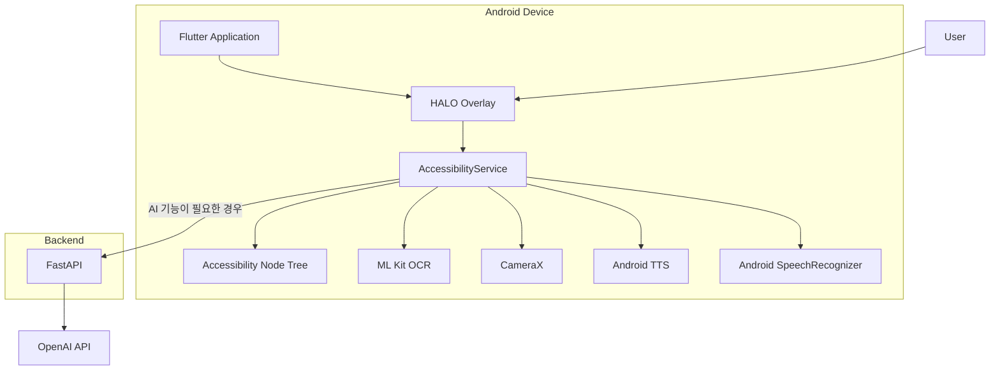
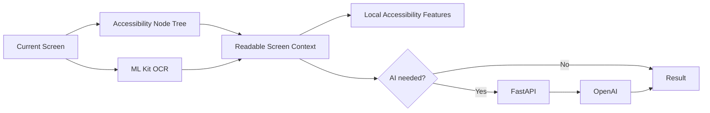

<div align="center">


<br><br>


</div>

---

# HaloVision V3

**시각장애인·저시력 사용자를 위한 AI 기반 상황 적응형 접근성 보조 시스템**

HaloVision V3는 사용자가 스마트폰 화면을 벗어나지 않고 필요한 순간에 접근성 기능을 호출할 수 있도록 설계한 Android 기반 시각 보조 애플리케이션입니다.

Android AccessibilityService를 기반으로 현재 화면의 텍스트와 UI 구조를 파악하고, ML Kit OCR과 AI 화면 분석을 결합하여 화면 읽기, 큰 글자 보기, 중요 정보 추출, 자연어 질문, UI 요소 탐색을 제공합니다.

<div align="center">

### 보기 → 읽기 → 이해 → 행동

</div>

---

## 주요 기능

### HALO 접근성 오버레이

다른 앱을 사용하고 있는 중에도 화면 위의 HALO 버튼을 통해 접근성 기능을 호출할 수 있습니다.

- 보기 편하게
- 중요한 내용만
- 화면 읽어줘
- 질문하기
- 사용자 설정
- HaloVision Camera

### 보기 편하게

현재 화면의 정보를 읽기 쉬운 형태로 제공합니다.

- 큰 글자로 보기
- 화면 확대
- 사용자 설정 글자 크기 반영
- 사용자 설정 확대 배율 반영

Accessibility Node Tree를 우선 활용하고, 화면 텍스트가 부족한 경우 ML Kit OCR로 보완합니다.

### 화면 읽어주기

현재 화면에서 읽을 수 있는 텍스트를 추출하여 Android Text To Speech로 읽어줍니다.

화면 정보는 Accessibility Node Tree와 ML Kit OCR을 함께 활용하며, 사용자는 읽기 속도를 설정할 수 있습니다.

### 중요한 내용만

현재 화면의 핵심 정보를 AI가 짧게 정리합니다.

먼저 Accessibility로 수집한 텍스트만 분석하고, 해당 정보만으로 화면 내용을 충분히 판단하기 어려운 경우에만 화면 이미지를 추가로 분석합니다.

### 화면 기반 질문하기

현재 보고 있는 화면에 대해 자연어로 질문할 수 있습니다.

```text
이 화면은 무슨 내용이야?
신청 기간이 언제야?
여기서 가장 중요한 내용이 뭐야?
로그인 버튼 찾아줘.
```

텍스트 정보만으로 답할 수 없는 경우에만 Vision 분석을 추가로 수행합니다.

### UI 요소 탐색

사용자가 원하는 버튼이나 항목을 자연어로 요청하면 Accessibility Node Tree의 텍스트와 좌표 정보를 이용하여 대상을 탐색합니다.

대상을 찾은 경우 실제 화면 위에 강조 표시하고, 필요한 경우 자동으로 아래 화면을 탐색합니다.

### HaloVision Camera

CameraX 기반 실시간 카메라 화면에서도 HALO 접근성 기능을 사용할 수 있습니다.

사진을 갤러리에 저장하고 별도 AI 앱에 첨부하는 과정을 줄이는 것을 목표로 합니다.

```text
HaloVision Camera
        ↓
실시간 카메라 화면
        ↓
HALO 호출
        ↓
OCR / 큰 글자 / 화면 읽기 / AI 질문
```

---

## System Architecture



HaloVision V3의 핵심 동작은 데이터베이스에 의존하지 않습니다.

일반적인 화면 읽기, 큰 글자 보기, UI 요소 탐색, 카메라 OCR은 Android 기기에서 로컬로 처리합니다. 화면 의미 이해가 필요한 기능만 FastAPI를 통해 OpenAI API를 호출합니다.

---

## 화면 처리 전략



### Local First

가능한 기능은 기기에서 처리합니다.

- Accessibility Node Tree 수집
- ML Kit OCR
- 큰 글자 보기
- 화면 읽어주기
- UI 요소 위치 탐색
- CameraX Preview OCR
- TTS / STT

### AI When Needed

화면의 의미 이해가 필요한 경우에만 서버를 사용합니다.

- 중요한 내용 요약
- 현재 화면 기반 자연어 질문
- 텍스트만으로 판단하기 어려운 화면의 Vision 분석

화면 이미지 분석이 필요하지 않은 경우에는 Accessibility 텍스트만 서버에 전달합니다.

---

## 데이터 처리 원칙

HaloVision V3의 현재 핵심 구조에서는 PostgreSQL, Supabase 등의 외부 데이터베이스 또는 이미지 저장소를 사용하지 않습니다.

- 사용자 접근성 설정: 기기 로컬 저장
- 일반 OCR 및 UI 탐색: 기기 로컬 처리
- AI 요청: 필요한 현재 화면 정보만 일시적으로 서버에 전달
- 화면 이미지: Vision 분석이 필요한 경우에만 전달
- 백엔드 데이터베이스 저장: 사용하지 않음
- OpenAI 요청 저장: 서버 코드에서 `store=False` 사용

---

## Tech Stack

| 구분 | 기술 |
|---|---|
| Mobile Framework | Flutter |
| Mobile Language | Dart |
| Android Native | Kotlin |
| Accessibility | Android AccessibilityService |
| Camera | CameraX |
| OCR | Google ML Kit Text Recognition |
| Voice Output | Android Text To Speech |
| Voice Input | Android SpeechRecognizer |
| Backend | FastAPI, Python |
| AI | OpenAI API |
| Server Deployment | Render |
| Version Control | GitHub |

---

## Project Structure

```text
halovision/
│
├── android/
│   └── app/src/main/kotlin/
│       └── com/example/halovision_app/
│           ├── MainActivity.kt
│           ├── HaloAccessibilityService.kt
│           └── HaloCameraActivity.kt
│
├── backend/
│   └── server.py
│
├── lib/
│   └── main.dart
│
├── assets/
│   └── images/
│
├── docs/
│   └── halovision_v3_banner.png
│
├── pubspec.yaml
└── README.md
```

---

## 실행 방법

### Flutter 앱

```bash
flutter pub get
flutter devices
flutter run
```

특정 기기를 지정할 경우:

```bash
flutter run -d DEVICE_ID
```

### Backend

```bash
cd backend
uvicorn server:app --host 0.0.0.0 --port 8000 --reload
```

Render 배포 환경에서는 Android 앱이 배포된 FastAPI 서버와 통신합니다.

---

## 접근성 서비스 설정

Samsung Galaxy 기준:

```text
설정
→ 접근성
→ 설치된 앱
→ HaloVision
→ 사용
```

카메라와 음성 기능을 사용할 경우 카메라 및 마이크 권한도 허용해야 합니다.

---

## 성능 측정

HaloVision V3에는 기능별 처리 시간을 확인하기 위한 `HALO_METRIC` 로그가 포함되어 있습니다.

측정 대상은 다음과 같습니다.

| 항목 | 측정값 |
|---|---|
| 큰 글자 보기 | 처리 시간, Node Tree/OCR 사용 여부 |
| 화면 읽어주기 | 처리 시간, Node Tree/OCR 사용 여부 |
| 중요한 내용만 | AI 응답 시간, Vision 사용 여부 |
| 질문하기 | AI 응답 시간, Vision 사용 여부 |
| UI 요소 찾기 | 탐색 성공률 |
| 전체 | 실패 횟수, OCR 사용률, Vision 사용률 |

실기기 테스트는 성능이 다른 Android 기기에서 수행하여 기능 호환성과 처리 시간을 함께 확인합니다.

---

## Current Status

| 기능 | 상태 |
|---|:---:|
| HALO 접근성 오버레이 | 완료 |
| Accessibility Node Tree 분석 | 완료 |
| ML Kit OCR | 완료 |
| 큰 글자로 보기 | 완료 |
| 화면 확대 | 완료 |
| 화면 읽어주기 | 완료 |
| AI 중요 내용 분석 | 완료 |
| 화면 기반 자연어 질문 | 완료 |
| UI 요소 탐색 및 위치 강조 | 완료 |
| 자동 스크롤 탐색 | 완료 |
| CameraX 기반 실시간 카메라 | 완료 |
| 카메라 화면 OCR | 완료 |
| 사용자 접근성 설정 | 완료 |
| 소형 Android 화면 대응 | 완료 |
| 실기기 호환성 및 성능 검증 | 진행 중 |
| Release 빌드 안정화 | 진행 중 |

---

## 향후 개발 방향

- 다양한 Android 기기 호환성 검증
- OCR 인식 정확도 정량 평가
- UI 요소 탐색 성공률 개선
- AI 응답 시간 및 비용 최적화
- 실제 시각장애인·저시력 사용자 대상 사용성 평가
- Release 빌드 안정화

---

<div align="center">


### HaloVision V3

**AI-based Context-Aware Accessibility Assistant**

</div>
