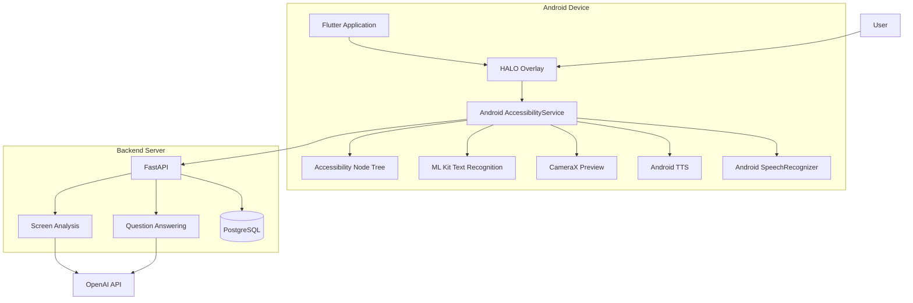
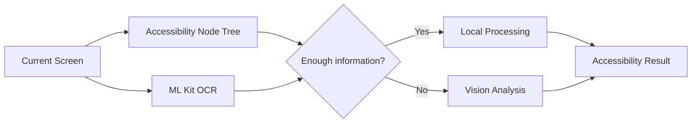

<div align="center">


<br><br>


</div>

---

# HaloVision V3

**시각장애인·저시력 사용자를 위한 AI 기반 상황 적응형 접근성 보조 시스템**

HaloVision V3는 사용자가 스마트폰을 이용하는 과정에서 현재 화면을 벗어나지 않고 필요한 접근성 기능을 바로 호출할 수 있도록 설계된 Android 기반 시각 보조 애플리케이션입니다.

Android AccessibilityService를 기반으로 현재 화면의 텍스트와 UI 구조를 파악하고, ML Kit OCR과 AI 화면 분석을 결합하여 화면 읽기, 큰 글자 보기, 중요 정보 추출, 자연어 질문, UI 요소 탐색 등의 기능을 제공합니다.

HaloVision의 핵심 목표는 사용자가 정보를 단순히 확인하는 것을 넘어 **읽고, 이해하고, 필요한 행동까지 이어갈 수 있도록 지원하는 것**입니다.

<div align="center">

### 보기 → 읽기 → 이해 → 행동

</div>

---

## 주요 기능

### HALO 접근성 오버레이

HaloVision의 핵심 인터페이스입니다.

Android AccessibilityService를 이용하여 웹 브라우저, 설정, 문서 앱 등 다른 애플리케이션을 사용하는 중에도 화면 위에 HALO 버튼을 표시합니다.

사용자는 현재 앱을 종료하거나 다른 화면으로 이동하지 않고 HALO를 호출하여 접근성 기능을 사용할 수 있습니다.

HALO 메뉴에서는 다음 기능을 제공합니다.

- 보기 편하게
- 중요한 내용만
- 화면 읽어줘
- 질문하기
- 사용자 설정
- HaloVision Camera

---

### 보기 편하게

현재 화면의 내용을 사용자가 더욱 쉽게 확인할 수 있도록 보조합니다.

주요 기능은 다음과 같습니다.

**큰 글자로 보기**

Accessibility Node Tree와 ML Kit OCR을 이용하여 현재 화면의 텍스트를 추출하고, 사용자가 설정한 크기의 텍스트로 다시 표시합니다.

**확대 보기**

Android 화면 확대 기능을 활용하여 필요한 영역을 확대해서 확인할 수 있습니다.

사용자는 설정에서 글자 크기와 확대 배율을 조절할 수 있습니다.

---

### 화면 읽어주기

현재 화면에서 읽을 수 있는 텍스트를 분석하여 음성으로 제공합니다.

화면 정보는 우선 Android Accessibility Node Tree에서 수집하며, 필요한 경우 ML Kit OCR을 이용해 화면의 텍스트를 추가로 인식합니다.

추출된 텍스트는 Android Text To Speech를 이용하여 읽어줍니다.

사용자는 설정에서 음성 읽기 속도를 변경할 수 있습니다.

---

### 중요한 내용만

현재 화면에 많은 정보가 표시되어 있을 때 AI가 화면 내용을 분석하여 사용자가 우선적으로 확인해야 할 핵심 내용을 제공합니다.

텍스트 기반 정보만으로 현재 화면을 충분히 판단하기 어려운 경우 화면 이미지를 이용한 Vision 분석을 추가로 수행합니다.

이를 통해 긴 웹 페이지나 복잡한 화면에서도 필요한 정보를 빠르게 파악할 수 있도록 지원합니다.

---

### 화면 기반 질문하기

사용자는 현재 보고 있는 화면에 대해 자연어로 질문할 수 있습니다.

예를 들어 다음과 같은 질문이 가능합니다.

```text
이 화면은 무슨 내용이야?

신청 기간이 언제야?

여기서 가장 중요한 내용이 뭐야?

다음 버튼은 어디 있어?

로그인 버튼 찾아줘.
```

HaloVision은 현재 화면에서 수집한 Accessibility 정보와 OCR 결과를 이용하여 질문에 답변합니다.

텍스트 정보만으로 답변하기 어려운 경우 Vision 분석을 활용합니다.

---

### UI 요소 탐색

사용자가 화면에서 원하는 버튼이나 메뉴를 찾기 어려운 경우 자연어를 통해 대상 UI 요소를 검색할 수 있습니다.

예를 들어,

```text
로그인 버튼 찾아줘

검색 버튼 어디 있어?

다음 버튼 찾아줘
```

와 같이 요청할 수 있습니다.

HaloVision은 Accessibility Node Tree에서 각 UI 요소의 텍스트와 위치 정보를 분석하여 대상 요소를 탐색합니다.

대상을 찾으면 실제 화면 위에 해당 위치를 강조하여 표시하며, 필요한 경우 자동 스크롤을 수행합니다.

---

### HaloVision Camera

스마트폰 화면뿐 아니라 주변의 문서와 텍스트를 확인하기 위한 CameraX 기반 카메라 기능을 제공합니다.

카메라 화면에서 별도의 사진 촬영 및 저장 과정 없이 HALO 기능을 사용할 수 있도록 설계했습니다.

```text
HaloVision Camera
        ↓
실시간 카메라 화면
        ↓
HALO 호출
        ↓
텍스트 인식
        ↓
큰 글자 / 화면 읽기 / AI 분석
```

카메라 영상은 CameraX Preview를 기반으로 표시되며, OCR이 필요한 경우 현재 Preview 프레임을 직접 활용합니다.

---

## System Architecture



HaloVision V3는 크게 **모바일 클라이언트, Android 접근성 서비스, 로컬 인식 기능, 백엔드 서버, AI 분석 시스템, 데이터베이스**로 구성됩니다.

---

## 화면 정보 처리 구조

HaloVision은 한 가지 방법에만 의존하지 않고 화면 특성에 따라 여러 정보를 함께 활용합니다.



### Accessibility Node Tree

Android가 제공하는 Accessibility 정보를 이용하여 현재 화면의 텍스트, 버튼, 메뉴, 설명 및 각 UI 요소의 화면 좌표를 수집합니다.

UI 요소 탐색이나 일반적인 앱 화면 분석에서는 Node Tree를 우선적으로 활용합니다.

### ML Kit OCR

Accessibility 정보만으로 화면의 실제 텍스트를 충분히 확보하기 어려운 경우 Google ML Kit Text Recognition을 이용합니다.

OCR은 화면 읽기 및 큰 글자 보기 기능에 활용됩니다.

### AI Vision

Node Tree와 OCR만으로 화면의 의미를 충분히 이해하기 어려운 경우 화면 이미지를 AI에 전달하여 추가 분석을 수행합니다.

이를 통해 텍스트뿐만 아니라 화면 전체의 문맥을 고려할 수 있습니다.

---

## 기능 처리 흐름

```text
현재 화면
    │
    ├──────────── Accessibility Node Tree
    │
    └──────────── ML Kit OCR
                     │
                     ▼
               화면 정보 구성
                     │
         ┌───────────┴───────────┐
         │                       │
         ▼                       ▼
     Local 기능                AI 기능
         │                       │
         │                 FastAPI Server
         │                       │
         │                   OpenAI API
         │                       │
         ▼                       ▼
    큰 글자 보기            중요 내용 분석
    화면 읽어주기           자연어 질문
    UI 요소 탐색            Vision 분석
         │                       │
         └───────────┬───────────┘
                     │
                     ▼
                 사용자 제공
```

---

## 사용자 설정

HaloVision은 사용자의 시각적 특성과 사용 환경에 맞춰 접근성 기능을 조절할 수 있도록 설정 기능을 제공합니다.

현재 지원하는 주요 설정은 다음과 같습니다.

| 설정 | 지원 옵션 |
|---|---|
| 글자 크기 | 32 / 40 / 48 / 56 |
| 화면 확대 | 1.5x / 2.0x / 2.5x / 3.0x |
| TTS 읽기 속도 | 느리게 / 보통 / 빠르게 / 매우 빠르게 |
| 질문 답변 자동 읽기 | ON / OFF |
| 중요 내용 자동 읽기 | ON / OFF |

설정값은 기기에 저장되어 HALO 기능 실행 시 자동으로 적용됩니다.

---

## Tech Stack

| 구분 | 기술 |
|---|---|
| Mobile Framework | Flutter |
| Mobile Language | Dart |
| Android Native | Kotlin |
| Accessibility | Android AccessibilityService |
| Camera | CameraX |
| OCR | Google ML Kit Text Recognition |
| Voice Output | Android Text To Speech |
| Voice Input | Android SpeechRecognizer |
| Backend | FastAPI |
| Backend Language | Python |
| AI | OpenAI API |
| Database | PostgreSQL |
| ORM | SQLAlchemy |
| Server Deployment | Render |
| Version Control | GitHub |

---

## Project Structure

```text
halovision/
│
├── android/
│   └── app/
│       └── src/main/
│           └── kotlin/
│               └── com/example/halovision_app/
│                   ├── MainActivity.kt
│                   ├── HaloAccessibilityService.kt
│                   └── HaloCameraActivity.kt
│
├── backend/
│   ├── server.py
│   ├── database.py
│   ├── models.py
│   └── storage.py
│
├── lib/
│   └── main.dart
│
├── assets/
│   └── images/
│
├── docs/
│   └── halovision_v3_banner.png
│
├── pubspec.yaml
└── README.md
```

---

## 실행 방법

### Flutter 패키지 설치

프로젝트 루트에서 다음 명령을 실행합니다.

```bash
flutter pub get
```

### Android 기기 연결 확인

```bash
flutter devices
```

### 앱 실행

```bash
flutter run
```

여러 Android 기기가 연결되어 있다면 Device ID를 지정할 수 있습니다.

```bash
flutter run -d DEVICE_ID
```

---

## 접근성 서비스 설정

HALO 오버레이 기능을 사용하려면 Android 접근성 서비스 권한이 필요합니다.

Samsung Galaxy 기준:

```text
설정
→ 접근성
→ 설치된 앱
→ HaloVision
→ 사용
```

기기에 따라 메뉴 이름은 일부 다를 수 있습니다.

카메라 및 음성 관련 기능을 사용하려면 카메라와 마이크 권한도 허용해야 합니다.

---

## Backend 실행

백엔드 폴더로 이동합니다.

```bash
cd backend
```

가상환경을 활성화한 후 FastAPI 서버를 실행합니다.

```bash
uvicorn server:app --reload
```

배포 환경에서는 Render 서버를 통해 Android 애플리케이션과 통신합니다.

---

## 개발 현황

현재 HaloVision V3의 핵심 프로토타입 기능을 구현한 상태입니다.

| 기능 | 상태 |
|---|:---:|
| HALO 접근성 오버레이 | 완료 |
| Accessibility Node Tree 분석 | 완료 |
| ML Kit OCR | 완료 |
| 큰 글자로 보기 | 완료 |
| 화면 확대 | 완료 |
| 화면 읽어주기 | 완료 |
| AI 중요 내용 분석 | 완료 |
| 화면 기반 자연어 질문 | 완료 |
| UI 요소 탐색 | 완료 |
| UI 위치 강조 | 완료 |
| 자동 스크롤 탐색 | 완료 |
| CameraX 카메라 | 완료 |
| 카메라 화면 OCR | 완료 |
| 사용자 접근성 설정 | 완료 |
| 소형 Android 화면 대응 | 완료 |
| 실제 Android 기기 테스트 | 진행 중 |
| Release 빌드 안정화 | 진행 중 |

---

## 개발 방향

HaloVision V3는 실제 모바일 환경에서 사용 가능한 접근성 보조 시스템을 목표로 지속적으로 개선하고 있습니다.

향후 주요 개발 방향은 다음과 같습니다.

- 다양한 Android 스마트폰 호환성 검증
- OCR 인식 정확도 향상
- UI 요소 탐색 정확도 향상
- 화면 문맥 분석 성능 개선
- 실제 시각장애인 및 저시력 사용자 대상 사용성 평가
- AI API 호출 비용 최적화
- Release 빌드 안정화
- Android 접근성 기능과 AI 기능의 통합 UX 개선

---

<div align="center">

<br>


### HaloVision V3

**AI-based Context-Aware Accessibility Assistant**

</div>